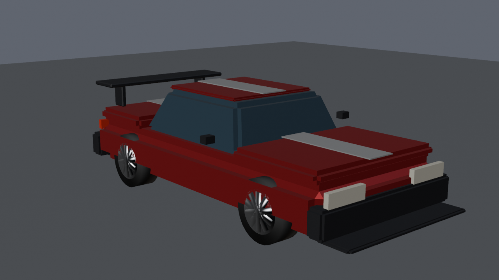

# 🏎️ Racing Game 3D — Blender & Unity

A 3D racing game developed using **Blender and Unity**, featuring procedural asset generation, customizable racing tracks, physics-based vehicle controls, and AI-controlled opponents.

Vehicles and environmental assets are generated using Python scripts in Blender and integrated into Unity, where the racing gameplay takes place.

<p align="center">
  
</p>

---

## 🎮 Overview

Racing Game 3D is a racing game project where players control a vehicle and compete against three AI opponents on a customizable racing track.

The project combines procedural modeling and asset generation in Blender with gameplay development in Unity. Racing environments, including roads, curbs, barriers, checkpoints, cones, and trees, are generated through custom scripts.

### Features

- 🏁 3-lap racing gameplay
- 🚗 Player-controlled vehicle
- 🤖 3 AI-controlled opponents
- 🛣️ Procedurally generated racing track
- 🏎️ Physics-based vehicle movement using WheelCollider
- 📍 Checkpoint and lap tracking system
- 🏆 Race position and ranking system
- ⏱️ Lap timer and race countdown
- 📷 Multiple camera perspectives
- 🔄 Checkpoint-based vehicle reset
- 🌳 Procedurally generated racing environment
- 🛠️ Automated project setup
- 🎨 Customizable vehicle and track settings

---

## 🛠️ Built With

| Technology | Description |
|---|---|
| Blender | 3D modeling and asset generation |
| Python | Procedural modeling and texture generation |
| Unity | Game engine and gameplay development |
| C# | Game logic, vehicle physics, AI, and UI |
| FBX | 3D asset interchange format |
| WheelCollider | Vehicle physics and wheel simulation |

---

## 📋 Requirements

### Development Environment

- **Unity:** Unity 2022.3 LTS
- **Unity 6:** Also supported
- **Render Pipeline:** Built-in Render Pipeline
- **Blender:** Blender 3.6 LTS or Blender 4.x
- **Platform:** Windows

The project was designed for Unity 2022.3 LTS using the Built-in Render Pipeline with the 3D template.

It can also run on Unity 6 and URP, with materials automatically adjusted through the project setup system.

---

## 📥 Clone Repository

Clone this repository to your local machine:

```bash
git clone https://github.com/iPanX10/RacingGame.git
```

Navigate to the project directory:

```bash
cd RacingGame
```

### Open the Project

1. Open **Unity Hub**.
2. Click **Add → Add project from disk**.
3. Navigate to the cloned repository.
4. Select the `RacingGame` project folder.
5. Open the project using Unity 2022.3 LTS or Unity 6.

---

## 🚀 Getting Started

### 1. Open the Project

Open the cloned `RacingGame` folder using Unity Hub.

Wait until Unity finishes importing the project assets.

### 2. Run the Automatic Setup

If an automatic setup dialog appears:

**"Jalankan setup otomatis?"**

Click **Yes**.

Alternatively, use the Unity menu:

```text
Racing → Setup Everything (1 klik)
```

### 3. Generate Game Assets

The automatic setup system will generate or configure:

- Materials
- Vehicle prefabs
- Racing environment assets
- Game configuration
- Racing scene

The main scene is generated at:

```text
Assets/Scenes/Race.unity
```

### 4. Configure Input System

If Unity displays a notification that Input Handling has been changed to **Both**, restart the Unity Editor once.

### 5. Start the Game

1. Open the scene:

   ```text
   Assets/Scenes/Race.unity
   ```

2. Press the **Play** button in Unity.

Start racing! 🏁

---

## 🎮 Controls

| Key | Function |
|---|---|
| `W` / `↑` | Accelerate |
| `S` / `↓` | Brake / Reverse |
| `A` / `←` | Steer Left |
| `D` / `→` | Steer Right |
| `Space` | Handbrake / Drift |
| `R` | Reset to Last Checkpoint |
| `C` | Change Camera View |
| `Esc` | Pause Game |
| `Enter` | Restart Race After Finishing |

---

## 🏗️ Project Structure

```text
RacingGame/
│
├── BlenderScripts/
│   ├── build_assets.py
│   └── make_textures.py
│
├── Assets/
│   ├── Editor/
│   │   └── RacingSetup.cs
│   │
│   ├── Materials/
│   │
│   ├── Meshes/
│   │
│   ├── Models/
│   │   ├── Barrier.fbx
│   │   ├── Car.fbx
│   │   ├── Cone.fbx
│   │   ├── StartGate.fbx
│   │   ├── Tree.fbx
│   │   └── Car_preview.png
│   │
│   ├── Prefabs/
│   │
│   ├── Scenes/
│   │   └── Race.unity
│   │
│   ├── Scripts/
│   │
│   └── Textures/
│
├── Packages/
│
└── ProjectSettings/
```

---

## 💻 Game Scripts

The game logic is implemented using C# scripts located in `Assets/Scripts`.

| Script | Description |
|---|---|
| `CarController.cs` | Handles vehicle physics, WheelCollider, engine torque, braking, steering, anti-roll, downforce, grass grip, handbrake, gear, and RPM. |
| `AICarDriver.cs` | Controls AI opponents, track following, corner braking, and automatic recovery when stuck. |
| `TrackBuilder.cs` | Generates the racing track, road, curbs, grass, finish line, checkpoints, barriers, cones, and trees. |
| `LapManager.cs` | Manages race countdown, checkpoint validation, lap tracking, race ranking, and lap records. |
| `RacerProgress.cs` | Stores racer progression and race-related information. |
| `Checkpoint.cs` | Handles checkpoint triggers and racer checkpoint validation. |
| `CameraFollow.cs` | Provides a following camera with dynamic field of view adjustments based on vehicle speed. |
| `EngineSound.cs` | Generates synthetic engine sounds without requiring external audio files. |
| `RaceHUD.cs` | Displays speed, gear, RPM, lap, position, timer, standings, and race results. |
| `PhysCompat.cs` | Provides physics compatibility functionality used by the project. |

---

## 🧩 Procedural Asset Generation

The project uses Python scripts in Blender to generate 3D assets and textures.

### `build_assets.py`

Generates the main 3D assets used in the racing game:

- Car
- Cone
- Barrier
- Tree
- Start Gate

The generated models are exported as FBX files and used in Unity.

### `make_textures.py`

Generates textures for the racing environment, including:

- Asphalt
- Grass
- Curb
- Finish Line

---

## 🎨 Customizing Assets

### Modifying the Vehicle

The vehicle can be customized directly through the Blender script:

```text
BlenderScripts/build_assets.py
```

Inside the `build_car` function, several parameters can be adjusted.

| Parameter | Description |
|---|---|
| `make_material("Car_Paint", ...)` | Changes the vehicle paint color |
| `L` | Vehicle length |
| `W` | Vehicle width |
| `wheel_r` | Wheel radius |
| `wheelbase` | Distance between front and rear wheels |
| `track` | Distance between left and right wheels |

Additional vehicle components such as spoilers, bumpers, and lights can also be modified through their corresponding code sections.

### Rebuilding Assets

1. Open Blender.
2. Navigate to the **Scripting** workspace.
3. Open `BlenderScripts/build_assets.py`.
4. Click **Run Script**.

The generated FBX files will automatically replace the existing assets in:

```text
Assets/Models/
```

Alternatively, use the terminal:

```bash
blender -b -P build_assets.py -- --out ../Assets/Models
```

After generating the assets, open Unity and run:

```text
Racing → Setup Everything
```

---

## 🛣️ Customizing the Racing Track

The racing track can be modified directly in Unity.

### Track Shape

1. Select the `Track` object in the Hierarchy.
2. Modify the `Control Points` values.
3. Adjust the track coordinates using `X` and `Z` values in meters.
4. Right-click the **Track Builder** component.
5. Select **Build Track**.

### Track Guidelines

- Maintain at least **50 meters** between control points.
- Avoid extremely sharp turns.
- Recommended minimum corner radius: approximately **20 meters**.

These guidelines help maintain smoother track geometry and more predictable vehicle movement.

---

## 🏁 Race Settings

### Number of Laps

Select the `RaceManager` object and modify:

```text
Total Laps
```

This determines the number of laps required to finish the race.

### AI Difficulty

Select an AI vehicle and modify:

```text
AI Car Driver → Skill
```

Recommended skill values:

| Skill | Difficulty |
|---|---|
| `0.6` | Easy |
| `1.0` | Normal |
| `1.05` | Hard |

Higher skill values can make AI opponents more competitive.

### Vehicle Performance

Vehicle handling and performance can be adjusted through the `Car Controller` component.

Available settings include:

- Engine torque
- Maximum speed
- Grip
- Steering
- Braking
- WheelCollider friction
- Downforce

---

## 📷 Camera System

The game features multiple camera perspectives that can be switched during gameplay.

Press:

```text
C
```

to cycle through available camera views, including:

- Close chase camera
- Far chase camera
- Hood camera

The chase camera also adjusts the field of view when the vehicle accelerates, creating a more dynamic driving experience.

---

## 🔧 Troubleshooting

### Keyboard Controls Do Not Respond

Navigate to:

```text
Edit → Project Settings → Player
```

Set:

```text
Active Input Handling → Both
```

or:

```text
Input Manager (Old)
```

Restart the Unity Editor after changing the setting.

### Pink Materials

Pink materials may indicate a render pipeline compatibility issue.

The project supports Built-in Render Pipeline and can adjust materials for URP.

Run:

```text
Racing → Setup Everything
```

to regenerate or configure materials.

### Vehicle Facing the Wrong Direction

If the vehicle faces the wrong direction or the wheels are not synchronized:

```text
Racing → Setup Everything
```

The setup system automatically detects the vehicle orientation based on the front lights.

> Wheel names such as `Wheel_FL`, `Wheel_FR`, `Wheel_RL`, and `Wheel_RR` must remain unchanged because they are referenced by the setup scripts.

### Vehicle Feels Too Slippery or Too Stiff

Adjust the `WheelCollider` friction settings in the `PlayerCar` prefab.

Look for:

```text
Forward Friction
Sideways Friction
Stiffness
```

Adjust the stiffness values to fine-tune the vehicle handling.

---

## 📌 Notes

- The front of the vehicle faces **-Y in Blender**, which corresponds to **+Z in Unity**.
- Wheel naming conventions must be preserved.
- Generated assets can be rebuilt from Blender at any time.
- The automatic setup system can be used to rebuild project configurations.
- The project is designed to be customizable through both Blender scripts and Unity components.

---

## 👨‍💻 About the Project

**Racing Game 3D — Blender & Unity**

A project exploring:

- 3D game development
- Procedural modeling
- Python scripting in Blender
- Unity gameplay programming
- Vehicle physics
- AI racing behavior
- Procedural environment generation
